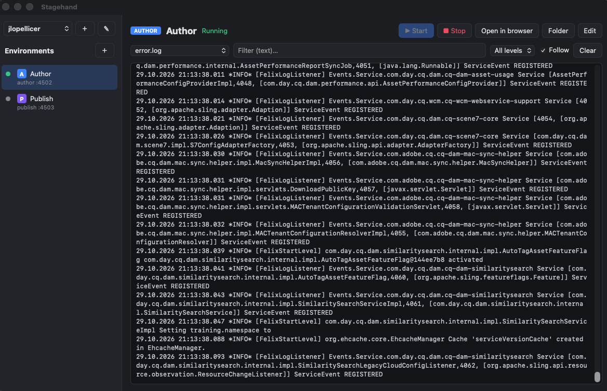
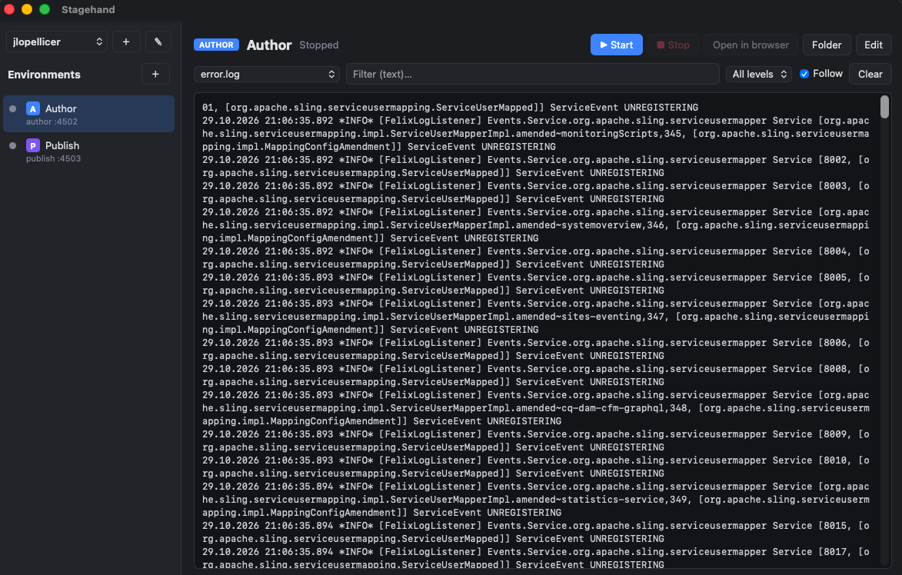
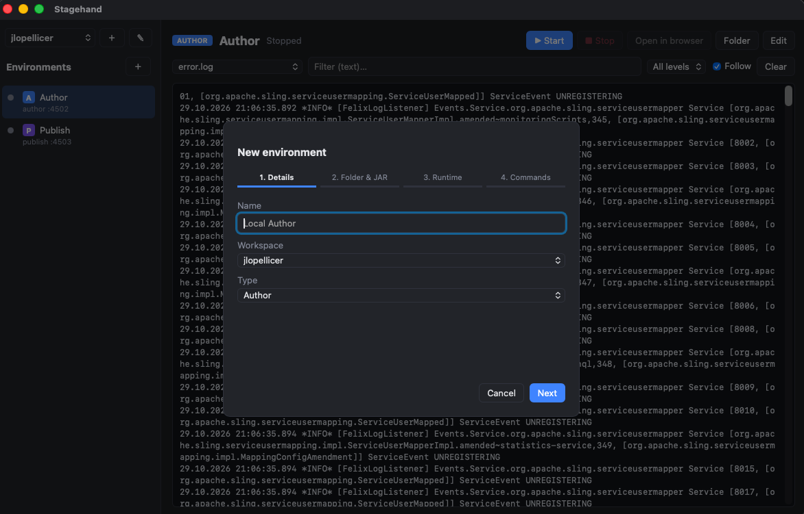
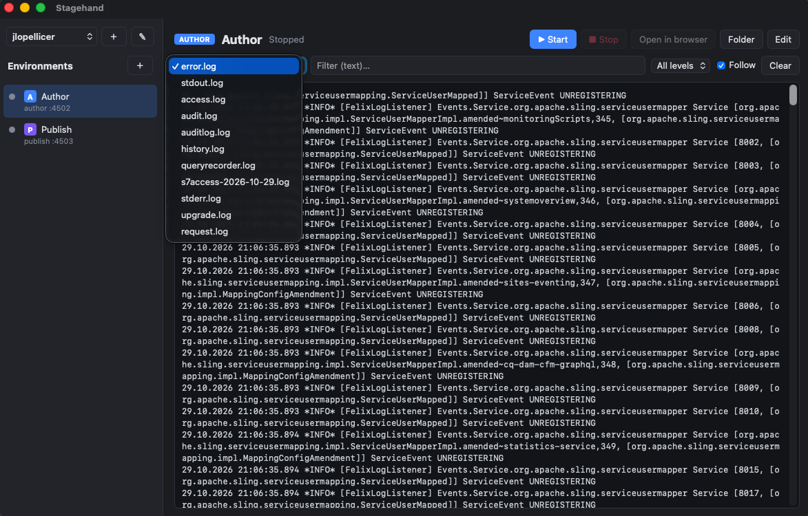

# Stagehand

> Local environment manager for Adobe Experience Manager.


**Stagehand** is a desktop app (macOS first; Linux and Windows from the same code) to **start, stop and read the logs** of local **Adobe Experience Manager** instances (Author and Publish) without using the terminal.

- Workspaces to group environments (e.g. one per client or project).
- Environment list with live status (Stopped / Starting / Running / Stopping).
- Start / Stop / Open in browser / Open folder buttons.
- Real-time viewer for any of the instance's logs (`error.log`, `stdout.log`, `request.log`, …) with text search and level filters.
- Per-environment settings: port, extra runmodes, JVM options (e.g. remote debug) and custom commands.

<p align="center"></p>

Stack: **Tauri 2** (Rust backend + plain HTML/JS UI with no build step). Small, cross-platform binaries.

## Requirements

- Rust (`rustup`) and the Tauri CLI: `cargo install tauri-cli --version "^2" --locked`
- Java installed (the version your AEM release needs) to run the instances.
- macOS: Xcode Command Line Tools (`xcode-select --install`).
- Linux: WebKitGTK dependencies (see https://tauri.app/start/prerequisites/). Windows: WebView2 + MSVC.

## Development

```bash
cargo tauri dev        # run the app with UI reload
cargo tauri build      # produce .app/.dmg (macOS), .deb/.AppImage (Linux), .msi (Windows)
cd src-tauri && cargo test
```

## Download

**[⬇ Download the latest macOS DMG (Apple Silicon)](https://github.com/JorgeRZT/Stagehand/releases/latest)** · direct link to the current version: [`Stagehand_2026.10.29_aarch64.dmg`](https://github.com/JorgeRZT/Stagehand/releases/download/v2026.10.29/Stagehand_2026.10.29_aarch64.dmg). All versions are listed under [Releases](https://github.com/JorgeRZT/Stagehand/releases). While the repository is private, you need to be signed in to GitHub with access to it.

## Releases

Installers are published as GitHub Releases tagged `v<YYYY.M.D>`; they are not stored in the source tree. Local builds are written to `dist/<YYYY.MM.DD>/` (git-ignored) (for example `dist/2026.10.29/Stagehand_2026.10.29_aarch64.dmg`). The app version follows the same calendar scheme. Run `scripts/release.sh` to build today's DMG and place it in the right folder. Builds are unsigned and not notarized yet: on first launch, right-click the app and choose *Open*.

## Features

### Workspaces
Group environments the way you work, for example **one workspace per client or project**, each with its own Author and Publish.

- The selector at the top of the left panel switches workspace; the app remembers the last one you used.
- **＋** next to it creates a workspace, **✎** renames or deletes it.
- Deleting a workspace only removes it (and its environments) from Stagehand's list. Files on disk are never deleted and running instances are not stopped.
- Existing environments live in a *Default* workspace; at least one workspace always exists.

### Author and Publish environments

<p align="center"></p>

- Each environment is an **Author** (default port 4502) or **Publish** (default port 4503) instance, shown in the list with an **A** or **P** icon, its status dot and its port.
- **Create** one with the **＋** next to *Environments*, using a 4-step wizard (**Next** / **Back**; Enter also advances; each step is validated):
  1. **Details:** name, workspace and type.
  2. **Folder and JAR:** pick the environment folder. If it contains a `.jar`, it is used to start the instance; if there are several, you choose which one is AEM; if there is none, you point to the JAR and it is **copied into the folder** when the environment is created.
  3. **Runtime:** port, extra runmodes (`author`/`publish` is added automatically) and JVM options, for example `-Xmx2g` or a remote-debug agent.
  4. **Commands (optional):** custom start and stop commands that override the defaults.

<p align="center"></p>

- **Edit** an environment at any time with the *Edit* button; every wizard step is reachable. The same dialog lets you move it to another workspace or remove it from the list.
- **Start:** runs the configured JAR with `java -jar <jar> -r <runmodes> -p <port>`, or `crx-quickstart/bin/start` if no JAR is configured, or your custom start command. The status goes *Starting…* and then *Running* once the port answers.
- **Stop:** runs `crx-quickstart/bin/stop` (or your custom stop command). If the script fails, Stagehand asks the process listening on the environment's port to exit. The status shows *Stopping…* until the port closes, which can take a couple of minutes; Stop stays enabled so you can retry.
- **Open in browser** opens the instance (`/aem/start.html` for Author, the site root for Publish) once it is running. **Folder** opens the environment folder in the file manager.
- Status is shown live for every environment (checked every 2 seconds), including instances that were started outside the app.
- Errors from start/stop (for example a port already in use, a missing JAR or the output of a failing stop script) are shown in a red banner above the logs.

### Logs
Every environment has a built-in log viewer, so nobody needs `tail -f` or to hunt for files in `crx-quickstart/logs`.

<p align="center"></p>

- **Any log file:** the dropdown lists every `*.log` in the instance's `crx-quickstart/logs` folder (`error.log`, `stdout.log`, `request.log`, `access.log`, `audit.log`, …), with the most useful ones first. Switch between them at any time.
- **Live view:** the selected log is tailed in real time (refreshed every second). It starts with the last 64 KB of the file and survives log rotation.
- **Follow:** keep the *Follow* checkbox on to auto-scroll to the newest line, or untick it to read in place.
- **Search content:** type in the filter box to show only the lines containing that text (case-insensitive). To search another log, select it in the dropdown; the filter stays applied.
- **Filter by level:** show only `ERROR`, `WARN` and above, or `INFO` and above. Lines without a level, such as stack-trace continuation lines, always stay visible.
- **Clear** empties the view without touching the file.
- Limits: the viewer keeps roughly the latest 400,000 characters of the selected log in memory, and search covers that window of the file that is currently selected, not every log at once.

## Usage

1. Create a workspace (or use *Default*).
2. Press **＋** next to *Environments* and complete the wizard to add an Author and a Publish.
3. Select an environment and press **Start**. Wait for the status to become *Running*.
4. Pick a log in the dropdown to watch startup, then use the text and level filters to find what you need.
5. Press **Open in browser** to use the instance.
6. Press **Stop** when you are done.

Configuration is stored in `~/Library/Application Support/com.stagehand.app/` (macOS), `~/.config/com.stagehand.app/` (Linux) or `%APPDATA%\com.stagehand.app\` (Windows), as `environments.json` and `workspaces.json`.

## Documentation

| File | Content |
|---|---|
| [ROADMAP.md](ROADMAP.md) | Planned work; next step: local Dispatcher support |
| [MEMORY.md](MEMORY.md) | Compact context for LLMs: decisions, conventions, status, gotchas. **Read first.** |
| [docs/ARCHITECTURE.md](docs/ARCHITECTURE.md) | Modules, data flow, backend ↔ UI API |
| [docs/EXTENDING.md](docs/EXTENDING.md) | Step-by-step recipes to add features |
| [docs/PORTING.md](docs/PORTING.md) | Linux / Windows: what changes and how to build |

All code and documentation in this repository is written in English.

## License

[MIT](LICENSE): free to use, modify, distribute and extend, including commercially. Contributions and forks are welcome.

## Known limitations

- Automated tests only cover log reading.
- "Starting" ends when the HTTP port accepts connections, even if AEM is still loading bundles.
- Status is detected by port: an instance started outside the app also shows as *Running*.
